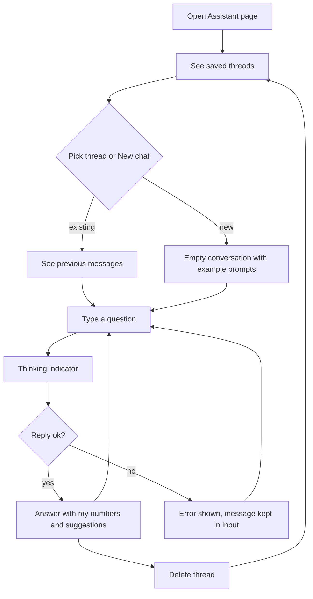

# Spec — AI Assistant Chat

## Problem Statement
A Bankclaw user can see their spending and wealth on fixed pages, and AI Coach and goal suggestions each give one canned output. When they have a specific question ("what did I spend on Grab in March?", "am I on track for my 100k goal?", "where can I cut back?"), they have to dig through pages and do the arithmetic themselves.

## Solution
An **Assistant** page in the dashboard. The user types a question in plain language and gets an answer that quotes their own numbers, with practical suggestions where relevant. Conversations are saved as threads they can reopen or delete. The assistant only reads data and never changes it.

## User Stories
1. As a Bankclaw user, I want to ask free-form questions about my transactions and portfolio, so that I get answers and advice without manual digging.
2. As a privacy-conscious user, I want the AI to see only what each answer needs, so that my full transaction history never leaves the server.

## Acceptance Criteria
- **AC1 — Ask and answer:** Given I have transactions in the selected profile, When I ask "How much did I spend on Food last month?", Then the reply states a total equal to the server-computed sum of that category and month (the same number the dashboard shows).
- **AC2 — Wealth questions:** Given I have assets, debts or goals, When I ask about my net worth or a goal, Then the reply uses my current net worth, debts and goal targets/dates.
- **AC3 — Follow-ups:** Given a thread with earlier messages, When I ask a follow-up ("and the month before?"), Then the reply uses the earlier context.
- **AC4 — Saved threads:** Given I sent a message, When I reload the page, Then the thread appears in my thread list titled from its first question, and opening it shows every message.
- **AC5 — New and delete:** When I click "New chat", Then an empty conversation starts. When I delete a thread, Then it disappears from the list and can't be opened again.
- **AC6 — Profile scope:** Given profile P is selected when I start a thread, When the assistant answers ledger questions in that thread, Then only P's transactions (or all, if "All" was selected) are used, even if I later switch the selector.
- **AC7 — Own data only:** Given another user's thread id, When I try to open, message or delete it, Then I get "not found" and no data is revealed.
- **AC8 — What reaches the LLM:** For any tool result sent to the model, Then it contains server-computed totals and at most 20 example rows, each with only date, description, amount and category.
- **AC9 — Guards:** A message over 2000 characters is rejected with a clear error. A reply uses at most 5 tool calls. At most the last 20 thread messages are sent as context.
- **AC10 — Degraded:** Given the AI key is not configured or the database is unavailable, When I open the page or send a message, Then I see a clear "not configured" / "database unavailable" message instead of a broken page. Given the AI call fails, Then I see "Assistant unavailable, try again" and my typed message is not lost.
- **AC11 — Waiting:** While a reply is being generated, a thinking indicator shows and the send button is disabled.

## User Journey

## Implementation Decisions
- **New backend assistant module.** It holds the read-only tools, the chat loop and the thread store. It uses DeepSeek through the existing OpenAI client and shared DeepSeek config, with a lazy `openai` import and a request timeout, following the goal advisor.
- **Tools** (OpenAI function-calling format), all scoped to the authenticated user and the thread's profile:
  - `cash_flow_summary(start, end, group_by = category | merchant | month, category?, merchant_contains?)` → income, spend and net totals, plus up to 25 groups with total and count.
  - `find_transactions(start, end, category?, merchant_contains?, min_amount?, max_amount?, sort = date | amount, limit ≤ 20)` → match count and total over **all** matches, plus ≤ 20 rows of {date, description, amount, category}.
  - `portfolio_summary()` → the existing goal-advisor aggregate (net worth, totals, allocation, indexed debts, monthly net-worth trend), plus each goal's name, kind, target and target date.
  Totals are always computed server-side. Unknown tools or bad arguments return an error object to the model rather than raising.
- **Chat loop.** System prompt (today's date, SGD, read-only, reply in the user's language, plain text with simple bullets) + last 20 thread messages + the new message. Tool rounds run until the model answers, up to 5 tool calls. After that, one final call with tools disabled forces an answer.
- **Thread store.** New Mongo collection `assistant_threads`, one document per thread: user email, profile id (fixed at creation), title (the first question trimmed to 60 characters), messages [{role: user|assistant, content, at}], created/updated timestamps. Indexed on user + updated. Only user and assistant text is saved, not tool traffic. The user message and the reply are appended together, only after a successful reply, so a failed turn leaves no half-written thread. **Approved DB change (intent).**
- **API contract** (all authenticated, all user-scoped):
  - `POST /api/assistant/messages` {thread_id?, profile_id?, message} → {thread: {id, title, updated_at}, reply}. With no thread_id, a thread is created on success.
  - `GET /api/assistant/threads` → {threads: [{id, title, updated_at}], configured}, newest first (≤ 50); `configured` says whether the AI key is set.
  - `GET /api/assistant/threads/{id}` → {thread: {id, title, profile_id, messages}}.
  - `DELETE /api/assistant/threads/{id}` → {deleted: true}.
  - Errors: 400 invalid input; 404 thread not found or not owned; 503 database or key missing; 502 AI failure (generic message, details logged). Mapped from the module's own exception types only.
- **Off the event loop.** Blocking LLM and Mongo work in the message route runs via `asyncio.to_thread`.
- **Prefactor.** The portfolio snapshot that the goal-suggestions route builds inline becomes one shared helper, used by both routes. Behaviour stays the same.
- **Frontend.** A new Assistant page component (thread list + conversation + composer), new API client functions, and an "Assistant" nav item shown in both Ledger and Portfolio modes. The page id is not tied to a mode, so switching modes keeps you on it. Replies render as plain text with line breaks preserved; no markdown library.

## Testing Decisions
- Test external behaviour at the highest test point; no assertions on prompt wording.
- **Tools** as pure functions over transaction records and a portfolio dict: totals, grouping, filters, 20-row cap, field whitelist (AC1, AC2, AC8).
- **Chat loop** with a fake LLM client that scripts tool calls: tool dispatch, 5-call cap then forced answer, 20-message history cap, typed errors (AC3, AC9, AC10).
- **Thread store** with MagicMock collections (prior art: portfolio repository tests): every query carries the user email; nothing is written on failure (AC4, AC5, AC7).
- **Routes** with stubbed pandas and the `_JsonRequest` helper (prior art: portfolio API tests): validation, status mapping, user and profile passed through (AC6, AC7, AC9, AC10).
- **Page** with a node render probe (prior art: goals render test): empty state, thread with messages, error and not-configured states, thinking indicator (AC10, AC11).
- **UI loop** in a real browser on a throwaway account with seeded data. Time one real DeepSeek call.

## Out of Scope
Streaming responses; write or one-click actions; Streamlit UI; a floating chat panel; daily message caps or billing; sending raw transaction lists; cross-user or shared threads; voice or file upload in chat; renaming threads.

## Further Notes
- Privacy-mode masking (the dashboard's amount blur) is not applied to assistant replies. Noted as a follow-up candidate.
- Dependencies: DeepSeek API key (`DEEPSEEK_API_KEY`) with function-calling support on the configured model; MongoDB; existing transaction and portfolio repositories.
